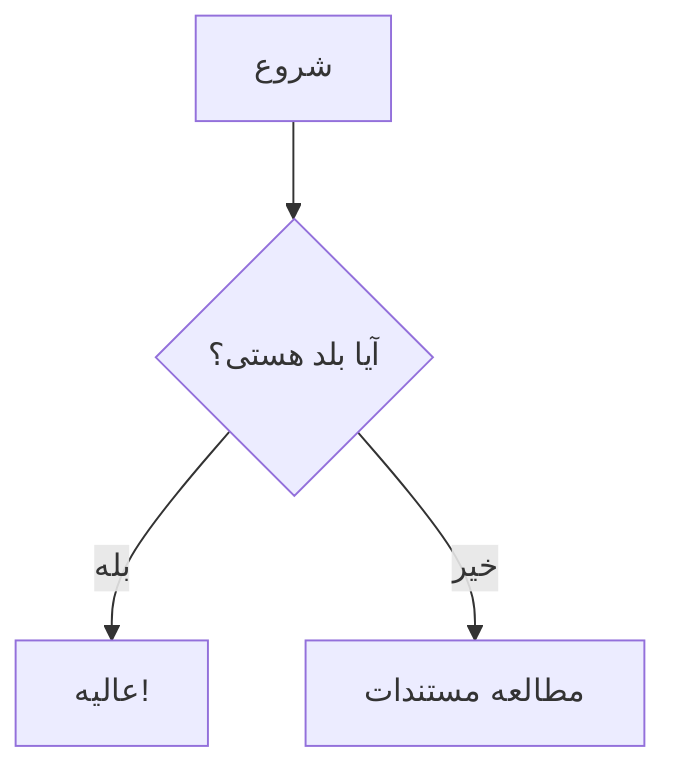
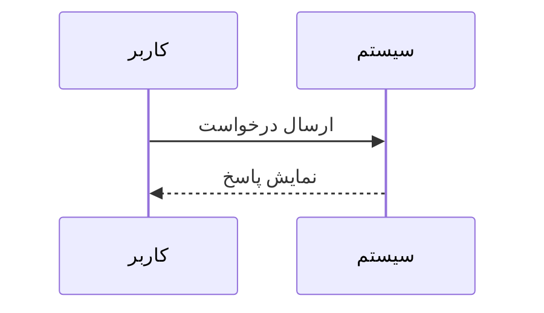
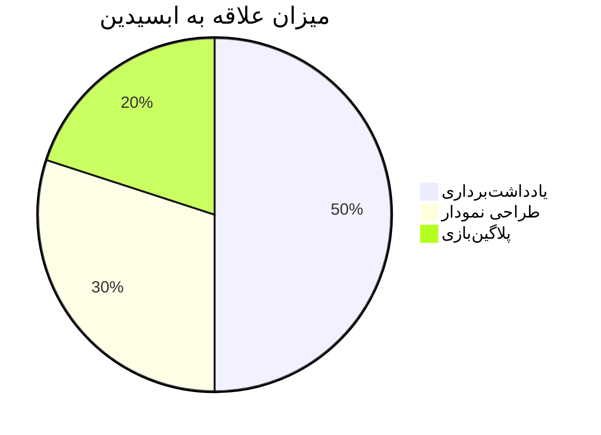
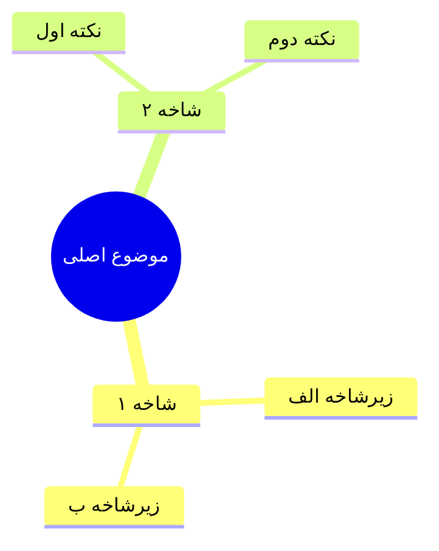

چشم محمد! اینم یک نت آموزشی کامل، خلاصه و تمیز (طبق اصل KISS) برای استفاده از Mermaid در ابسیدین:

---

# 📚 راهنمای سریع استفاده از Mermaid در ابسیدین

برای کشیدن نمودار بدون افزونه، از بلوک کد `mermaid` استفاده کن.

## ۱. نمودار درختی (Mindmap / Flowchart)
برای درخت و جریان کار:

* جهت‌ها: `TD` (بالا به پایین)، `LR` (چپ به راست).

---

## ۲. نمودار ترتیبی (Sequence Diagram)
برای نمایش ارتباطات و زمان‌بندی:

---

## ۳. نمودار دایره‌ای (Pie Chart)
برای نمایش درصد و آمار:

---

## ۴. نقشه ذهنی واقعی (Mindmap)
اگر ساختار درختی خالص می‌خوای:

---
💡 **نکته:** هر کجای متن که این بلوک‌ها رو بذاری، ابسیدین خودش اتوماتیک به شکل گرافیکی و وسط صفحه رندرشون میکنه.